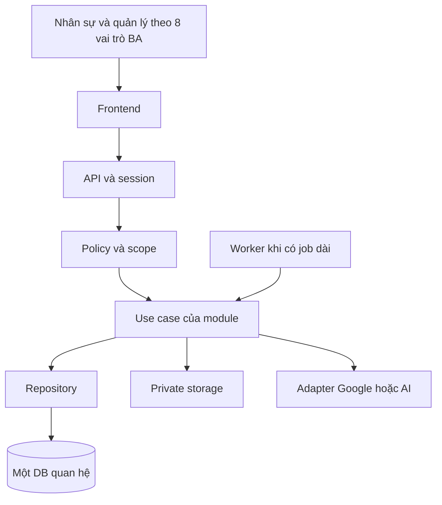
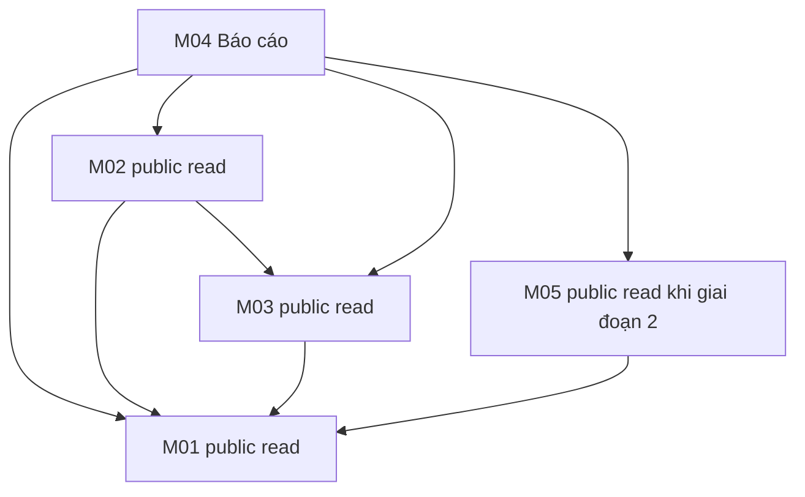

# Kiến trúc và cấu trúc toàn dự án

Đây là **bản đồ đích**, không phải danh sách file code đã tồn tại. Bộ bàn giao hiện có folder giữ chỗ, bốn manifest workspace, tài liệu BA và công cụ nội bộ; chưa có source ứng dụng. Tạo source/config/schema khi triển khai đúng trách nhiệm thực tế.

## Bốn workspace

| Đường dẫn | Vai trò | Khi triển khai |
| --- | --- | --- |
| apps/web | FE Next.js/React/TypeScript, styling theo nhận diện công ty | src/app là router mỏng; UI nằm trong src/modules |
| apps/api | Next.js Route Handlers/TypeScript, backend modular monolith | src/app/api/v1 là HTTP composition; logic nằm trong src/modules |
| packages/database | Prisma và DB dùng chung | Một nguồn model và một migration history |
| packages/contracts | DTO/schema thuần | Không import FE, BE, Prisma, Next server hoặc secret |

Giữ npm workspaces apps/* và packages/*. Đã có manifest tối thiểu; chưa cài/khóa version dependency hoặc sinh lockfile. PostgreSQL là đề xuất cũ; ERD BA dùng kiểu MySQL. Chốt provider/major trước khi thiết lập Prisma; không trộn recipe khác major.

## Danh mục thư mục đích

| Vùng | Thư mục/file đích |
| --- | --- |
| Root | AGENTS.md; AI_START_HERE.md; AI_CONTEXT.md; README.md; package.json; .gitignore; .env.example. Lockfile chỉ có sau khi khóa dependency |
| FE route | apps/web/src/app/(auth)/login/; (workspace)/layout.tsx; leads/; tracking/; ads/; reports/; design/; notifications/; profile/ |
| FE Core | apps/web/src/core/ui/; layout/; http/; session/ |
| FE module | apps/web/src/modules/01-leads/; 02-tracking-sync/; 03-keywords-ads/; 04-reports/; 05-ai-design/ |
| API route | apps/api/src/app/api/v1/auth/; users/; notifications/; leads/; tracking/; ads/; reports/; design/ |
| API Core | apps/api/src/core/auth/; permissions/; http/; audit/; storage/; notifications/; jobs/; config/ |
| API module | apps/api/src/modules/01-leads/; 02-tracking-sync/; 03-keywords-ads/; 04-reports/; 05-ai-design/ |
| Worker | apps/api/src/workers/; tạo run-jobs.ts khi có job thực tế |
| DB | packages/database/prisma/schema.prisma và models/ khi major hỗ trợ layout đó; migrations/ dùng chung; src/client.ts, transaction.ts, prisma.config.* đúng major khi triển khai |
| Contracts | packages/contracts/src/common/ và 5 thư mục module cùng tên |
| Tests | __tests__/ cạnh module/core; tests/e2e/auth/ và từng module; tests/fixtures/<module>/; liên module có vùng riêng khi cần |
| Tooling | scripts/check-scope.js, prepare-context.js, check-docs.js hiện có. Import-boundary/cycle check vẫn cần triển khai khi có app |
| Tài liệu | docs/; modules/; database/; handoffs/; tasks/m01…m05/; decisions/; runbooks/; sources/; reviews/; archive/ |
| Hạ tầng | infra/local/; infra/deploy/ theo host được chọn |
| Git | .github/pull_request_template.md; workflows/ci.yml khi check có thật; CODEOWNERS khi có username thật |
| Hướng dẫn AI | AGENTS.md là rule chính; giữ bộ skill đã cài nếu có. Gói này không tạo/cài .agents/skills hoặc tải vendor |

Trong bảng, phần sau dấu chấm phẩy cùng thuộc đường dẫn vùng tương ứng. Tên module luôn đầy đủ 01…05; <module> là ký hiệu tài liệu, không phải tên folder thật. [MODULE_MAP](MODULE_MAP.md) liệt kê đường dẫn đầy đủ của từng nhóm.

## Luồng xử lý logic

FE gọi HTTP; same-origin/proxy là lựa chọn wiring khi scaffold, không thay quyền ở API. Backend kiểm tra session, account active, action và phạm vi trước truy vấn/thay đổi; output serializer áp biểu diễn ẩn danh theo UC01.

## File bên trong module

| Vị trí tương lai | Trách nhiệm |
| --- | --- |
| FE index.ts | Public entry cho router/composition |
| FE api.ts | HTTP client dùng contracts |
| FE components/pages/hooks | UI/state, loading/empty/error; chỉ tách khi cần |
| BE public.ts | Public use case/read contract, không export toàn bộ nội bộ |
| BE policy.ts | Quyền BA và scope tài nguyên |
| BE service.ts hoặc use-cases/ | Nghiệp vụ và transaction |
| BE repository.ts | Query thuộc module |
| Contracts index.ts/schema | Dữ liệu request/response thuần |
| __tests__/ | Test hành vi phù hợp |

Không tạo controller/mapper/service/repository theo từng thao tác nếu trách nhiệm chưa cần tách.

## Hướng phụ thuộc code đề xuất

Đây là hướng import/public contract đề xuất, không sao chép hướng mũi tên nghiệp vụ. Ví dụ webhook: lớp app gọi phần bóc tách UC03 của M02 rồi public ingest M01; M01 không phải import ngược M02. Phản hồi thiết kế hiển thị trên Lead qua composition hoặc endpoint M05, không buộc M01 và M05 import nhau.

M02 chỉ upsert metric thuộc M03 qua contract đã chốt; M03 không gọi ngược repository M02. M04 không tự query bảng nguồn; dùng read contract có scope hoặc view được owner thống nhất. Core không import các module.

## DB, job và file

Model có thể tách core và 5 file module khi major đã chọn hỗ trợ; cấu hình phải đọc toàn bộ nguồn model. Không tạo file .prisma rỗng trong gói tài liệu. Một thư mục migrations và một người điều phối hợp nhất.

Query trong repository, transaction ngắn ở use case; cùng client cho các ghi liên quan. Không ôm provider/upload trong transaction. Worker dùng cùng codebase/module/DB nhưng lifecycle riêng khi cần; scheduler chỉ giao việc, không chạy tác vụ dài trong request.

File thương hiệu công khai có thể ở public/brand; file khách/thiết kế/báo cáo dùng private storage và kiểm tra quyền. DB/storage/provider readiness là trạng thái riêng; health sống không chứng minh các tích hợp đã được xác minh.

## Bàn giao AI

Bắt đầu từ [AI_START_HERE](../AI_START_HERE.md); mỗi module có handoff ngắn và task riêng. [AI_HANDOFF](AI_HANDOFF.md) quy định đọc có chọn lọc, ngân sách context và cập nhật trạng thái. Giữ tài liệu BA chi tiết làm nguồn tra cứu, không nạp mặc định cả bộ.
